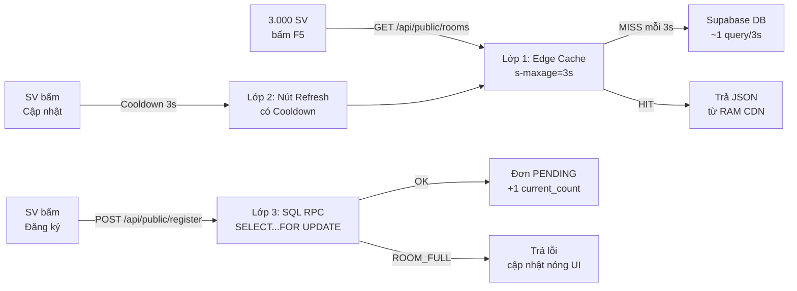

# LỘ TRÌNH TRIỂN KHAI HỆ THỐNG WEB QUẢN LÝ KÝ TÚC XÁ (ONLINE) — V2

> [!NOTE]
> **Phiên bản 2.0** — Cải tiến từ v1 dựa trên đánh giá tính khả quan: điều chỉnh timeline thực tế hơn, bổ sung Audit Log, Rate Limiting, Error Recovery, chuẩn hóa schema, và tối ưu batch import.

---

## 1. Tổng quan Dự án & Kiến trúc Hệ thống

### 1.1. Mục tiêu & Quy mô
* **Quy mô:** 300 phòng, phục vụ tối đa 3.000 sinh viên truy cập và đăng ký đồng thời không sập hệ thống.
* **Phân quyền:**
  * **1 Tài khoản Admin duy nhất:** Toàn quyền cấu hình hệ thống (Zero-Code), không cần lập trình viên can thiệp sau bàn giao.
  * **Cổng Sinh viên (Public Portal):** Truy cập trực tiếp qua đường link (không cần đăng ký tài khoản), xem sơ đồ phòng trống, nhãn giới tính động (Nam/Nữ/Trống), tiện ích, sức chứa, điền phiếu đăng ký và tra cứu kết quả.
* **Chi phí vận hành:** 0 đồng (sử dụng 100% gói miễn phí, thiết kế chống ngủ đông để vận hành bền vững nhiều năm).
* **Kế thừa nghiệp vụ thực tế (từ phần mềm EduSoft.NET cũ):** Phân cấp `Tòa nhà/Dãy -> Tầng -> Phòng`, hỗ trợ phòng sức chứa `0` (bảo trì/kho), cho phép Admin ghi đè xếp vượt sức chứa trong ca ngoại lệ, quản lý chuyển phòng/thanh lý, nạp danh sách SV khóa cũ (Import Excel) và xuất danh sách tạm trú gửi công an (Export Excel).

### 1.2. Công nghệ sử dụng (Tech Stack — 100% Free Tier)

| Thành phần | Công nghệ | Vai trò & Giới hạn Free Tier |
| :--- | :--- | :--- |
| **Frontend & API** | Next.js (App Router, TypeScript), Tailwind CSS, Shadcn/UI | Deploy trên **Vercel Hobby** (100GB Bandwidth, 1.000.000 Edge Requests/tháng). **Lưu ý: Serverless Function timeout = 10 giây.** |
| **Database & Auth** | **Supabase (PostgreSQL)** | 500MB DB, 200 kết nối đồng thời qua Transaction Pooler (Port `6543`), xác thực 1 tài khoản Admin. **Lưu ý: RPC rate limit ~100 req/s trên free tier.** |
| **Chống Bot/Spam** | **Cloudflare Turnstile** | Miễn phí, chặn tool auto-click/spam đơn ngay tại nút đăng ký. |
| **Chống ngủ đông DB** | **GitHub Actions (Cron Job)** | Tự động ping Supabase mỗi 3 ngày/lần để tránh cơ chế Auto-Pause sau 7 ngày không hoạt động. **Có cơ chế alert nếu ping thất bại.** |
| **Xử lý Excel** | **SheetJS (`xlsx`)** | Import/Export Excel trên trình duyệt (Client-side), không tốn tài nguyên Server. **Import lớn (>500 dòng) dùng chunked batch.** |
| **Kiểm thử chịu tải** | **k6 (Grafana)** | Giả lập 3.000 người dùng ảo (VUs) kiểm chứng trước khi bàn giao. |

### 1.3. Kiến trúc Chịu tải 3 Lớp (Chống sập & Chống tranh chấp chỗ)

1. **Lớp 1 — Edge Cache 3 giây (Luồng Đọc):** API lấy danh sách 300 phòng gắn header `Cache-Control: public, s-maxage=3, stale-while-revalidate=5`. 3.000 sinh viên F5 cùng lúc chỉ đọc từ RAM của CDN, Supabase chỉ xử lý tối đa 1 truy vấn mỗi 3 giây.
2. **Lớp 2 — Nút làm mới có Cooldown 3 giây:** Không dùng Auto-polling hay Realtime WebSocket. Giao diện tải 1 lần và có nút **"Cập nhật phòng trống"** bị khóa 3 giây sau mỗi lần bấm để bảo vệ hạn mức request miễn phí.
3. **Lớp 3 — Khóa mức dòng PostgreSQL (Luồng Ghi):** Khi sinh viên bấm "Đăng ký", request `POST` đi thẳng xuống hàm SQL RPC trên Supabase sử dụng `SELECT ... FOR UPDATE` trên đúng dòng của phòng được chọn. Nếu phòng vừa hết chỗ trong khoảng trễ 3 giây của Cache, DB từ chối ngay lập tức, trả mã lỗi `ROOM_FULL` và giao diện tự động cập nhật nóng trạng thái phòng thành "Đã đầy" trên máy sinh viên.

### 1.4. Giới hạn Free Tier & Ngưỡng an toàn *(MỚI)*

> [!IMPORTANT]
> Bảng dưới đây tính toán mức tiêu thụ dự kiến trong ngày cao điểm (mở cổng đăng ký) để đảm bảo hệ thống không vượt hạn mức free tier.

| Tài nguyên | Giới hạn Free/tháng | Tiêu thụ dự kiến ngày cao điểm | Dư địa |
| :--- | :--- | :--- | :--- |
| Vercel Bandwidth | 100 GB | ~750 MB (50KB × 3.000 × 5 lần) | ✅ Rất an toàn |
| Vercel Edge Requests | 1.000.000 | ~30.000 (ngày cao điểm) | ✅ An toàn |
| Supabase DB Storage | 500 MB | ~20 MB (3.000 đơn + schema) | ✅ Rất an toàn |
| Supabase Connections | 200 (Pooler) | ~50 đồng thời (nhờ Cache lớp 1) | ✅ An toàn |
| Supabase RPC Rate | ~100 req/s | ~50 req/s (đỉnh POST đăng ký) | ⚠️ Cần giám sát |
| GitHub Actions | 2.000 phút/tháng | ~10 phút (10 cron jobs × 1 phút) | ✅ Rất an toàn |

---

## 2. Quy tắc Phối hợp giữa AI và Con người (AI Execution Protocol)

> **CHỈ THỊ BẮT BUỘC DÀNH CHO AI THỰC THI KẾ HOẠCH NÀY:**
> 1. **Điểm dừng Con người (`[HUMAN ACTION REQUIRED]`):** Bất cứ khi nào gặp khối `[HUMAN ACTION REQUIRED]`, AI **PHẢI DỪNG LẠI**, liệt kê rõ các việc cần người dùng thao tác (tạo tài khoản, cấp API Key, cấu hình dashboard bên thứ 3, xác nhận mẫu biểu...) và **chờ người dùng xác nhận hoàn tất** trước khi chuyển sang bước tiếp theo. Không được tự bịa key hoặc bỏ qua bước này.
> 2. **Cổng Kiểm thử (`[QUALITY GATE - KIỂM THỬ]`):** Sau khi hoàn thành toàn bộ task code của một Sprint, AI **BẮT BUỘC** phải thực hiện kiểm thử (viết/chạy test script hoặc hướng dẫn người dùng test thủ công). Chỉ được phép chuyển sang Sprint kế tiếp khi toàn bộ tiêu chí kiểm thử của Sprint hiện tại đều **PASS 100%**.
> 3. **Quy tắc Error Recovery *(MỚI)*:** Khi gặp lỗi deploy, lỗi SQL, hoặc test fail, AI phải: (a) Ghi nhận lỗi rõ ràng, (b) Thử sửa tối đa 2 lần, (c) Nếu vẫn fail → dừng lại mô tả lỗi chi tiết cho người dùng và đề xuất phương án thay thế. Không được lặp vô hạn.

---

## 3. Bảng tổng hợp Lộ trình 6 Sprint (21 Ngày)

> [!NOTE]
> **Thay đổi so với v1:** Mở rộng từ 14 ngày → 21 ngày, tách Sprint 3 (Admin panel) thành 2 sprint riêng biệt, thêm 1 ngày buffer cho Sprint cuối.

| Sprint | Thời lượng | Trọng tâm | Các bước cần Người dùng thao tác |
| :--- | :--- | :--- | :--- |
| **Sprint 1** | Ngày 1 – 3 | Hạ tầng, Database Schema, SQL RPC, RLS & **Audit Log** | Tạo Repo GitHub, Tài khoản Supabase (Singapore), Tài khoản Admin, Kết nối Vercel, Cài GitHub Secrets. |
| **Sprint 2** | Ngày 4 – 7 | Cổng Sinh viên, Edge Cache 3s, Turnstile & Tra cứu | Tạo tài khoản & lấy key Cloudflare Turnstile, Cập nhật `.env`/Vercel, Test trên điện thoại. |
| **Sprint 3** | Ngày 8 – 11 | Admin Auth, Master Data, Bulk Room Generator & Bản đồ phòng | Chốt danh sách tòa nhà/quy ước mã phòng; Test đăng nhập Admin. |
| **Sprint 4** | Ngày 12 – 14 | Admin: Dynamic Form Builder, Cài đặt Hệ thống & Dashboard | Chốt trường Form mở rộng mặc định; Test toàn bộ Zero-Code config. |
| **Sprint 5** | Ngày 15 – 18 | Duyệt đơn, Chuyển phòng, Import/Export Excel | Cung cấp mẫu Excel tạm trú & danh sách SV mẫu; Kiểm tra file xuất. |
| **Sprint 6** | Ngày 19 – 21 | Stress Test 3.000 VUs, Tối ưu, Tài liệu & Bàn giao | Cài k6, xác nhận chạy test, cấu hình tên miền, nghiệm thu UAT. |

---

## 4. Chi tiết Triển khai từng Sprint

---

### SPRINT 1: Hạ tầng, Cơ sở dữ liệu, SQL RPC & Audit Log (Ngày 1 – 3)

**Mục tiêu:** Dựng xong mã nguồn khung Next.js, **7 bảng** PostgreSQL (thêm `audit_logs`), các hàm RPC xử lý nguyên tử (Atomic Transactions), bảo mật RLS và Cron Job chống ngủ đông Database.

#### Bước chuẩn bị tài khoản (Điểm dừng 1.1)
> **[HUMAN ACTION REQUIRED — AI PHẢI DỪNG VÀ HỎI NGƯỜI DÙNG]**
> Trước khi viết code kết nối và chạy Migration, AI phải hỏi và yêu cầu người dùng hoàn thành các việc sau:
> 1. **GitHub:** Tạo 1 Repository mới (Private hoặc Public) cho dự án và cung cấp đường link repo (hoặc xác nhận đã khởi tạo git local).
> 2. **Supabase:** Đăng ký/Đăng nhập [supabase.com](https://supabase.com) -> Tạo 1 Project mới (**Bắt buộc chọn Region: `Southeast Asia (Singapore)`** để tối ưu tốc độ tại Việt Nam).
> 3. **Cung cấp thông tin kết nối Supabase (để điền vào `.env.local`):**
>    * `NEXT_PUBLIC_SUPABASE_URL` (Project URL)
>    * `NEXT_PUBLIC_SUPABASE_ANON_KEY` (anon public key)
>    * `SUPABASE_SERVICE_ROLE_KEY` (service_role secret key — tuyệt đối không lộ lên client)
>    * Chuỗi kết nối **Transaction Pooler (Port 6543)** (nếu cần chạy script migration/test).
> 4. **Vercel:** Đăng ký/Đăng nhập [vercel.com](https://vercel.com) (dùng tài khoản GitHub), Import repo dự án để sẵn sàng deploy preview.
>
> *Câu hỏi mẫu AI cần gửi:* "Để bắt đầu Sprint 1, bạn vui lòng tạo Repo GitHub, tạo Project Supabase (Region Singapore) và kết nối Vercel trước nhé. Sau khi xong, bạn hãy tạo file `.env.local` (hoặc gửi mình xác nhận đã điền đủ URL, Anon Key, Service Role Key) để mình tiến hành khởi tạo dự án và đẩy schema SQL."

#### Danh sách Task kỹ thuật
* **T1.1 — Khởi tạo dự án Next.js:**
  * Khởi tạo Next.js (App Router, TypeScript, Tailwind CSS), cài đặt `shadcn/ui`, `@supabase/supabase-js`, `@supabase/ssr`, `zod`, `lucide-react`.
  * Thiết lập cấu trúc thư mục rõ ràng: `app/(public)`, `app/admin`, `app/api`, `lib/supabase`, `supabase/migrations`.
  * ***(MỚI)*** Cấu hình `next.config.js` với `headers()` bổ sung security headers cơ bản (`X-Frame-Options`, `X-Content-Type-Options`, `Referrer-Policy`).

* **T1.2 — Viết file SQL Migration cho 7 bảng cốt lõi (`supabase/migrations/001_init_schema.sql`):**

  1. `system_config`: `id` (singleton), `is_portal_open` (boolean), `open_at` (timestamptz), `close_at` (timestamptz), `announcement` (text), `dynamic_fields` (JSONB lưu danh sách câu hỏi mở rộng).
  2. `registration_waves`: `id`, `name`, `is_active` (boolean — tạo Partial Unique Index đảm bảo chỉ có tối đa 1 đợt `is_active = true`), `created_at`.
  3. `buildings`: `id`, `code` (UNIQUE, VD: D4, D6, D10), `name`, `is_locked` (boolean), `sort_order` (int).
  4. `amenities`: `id`, `name`, `icon`.
  5. `rooms`: `id`, `building_id` (FK), `floor` (int), `room_code` (UNIQUE), `capacity` (int >= 0), `current_count` (int >= 0), `price` (numeric), `gender_type` (`EMPTY`/`MALE`/`FEMALE`), `fixed_gender` (`NULL`/`MALE`/`FEMALE`), `is_locked` (boolean), `note` (text). Tạo Index trên `(building_id, is_locked, gender_type)`.
  6. ***(THAY ĐỔI)*** `room_amenities`: **Junction table** thay cho `amenity_ids UUID[]` — gồm `room_id` (FK), `amenity_id` (FK), composite PK. Cho phép query ngược "phòng nào có điều hòa?" hiệu quả với Index.
  7. `registrations`: `id`, `wave_id` (FK), `room_id` (FK), `student_code`, `full_name`, `gender` (`MALE`/`FEMALE`), `dob` (date), `extra_data` (JSONB), `status` (`PENDING`/`APPROVED`/`REJECTED`/`CHECKED_OUT`), `reject_reason` (text), `created_at`. Tạo Partial Unique Index trên `(wave_id, student_code)` với điều kiện `WHERE status IN ('PENDING', 'APPROVED')` (để SV bị từ chối vẫn được đăng ký lại).
  8. ***(MỚI)*** `audit_logs`: `id` (UUID), `actor` (text — 'SYSTEM' hoặc Admin email), `action` (text — VD: `APPROVE_REG`, `TRANSFER_ROOM`, `OVERRIDE_CAPACITY`, `LOCK_BUILDING`, `IMPORT_BATCH`), `target_type` (text — `registration`/`room`/`building`/`system_config`), `target_id` (UUID), `details` (JSONB — snapshot trước/sau thay đổi), `created_at` (timestamptz DEFAULT `now()`). Index trên `(action, created_at)`.

* **T1.3 — Viết các PostgreSQL RPC Functions (`002_rpc_functions.sql`):**
  * `register_dorm_room(...)`: Sử dụng `SELECT ... FROM rooms WHERE id = p_room_id FOR UPDATE` khóa mức dòng; kiểm tra tuần tự 6 điều kiện (cổng mở & trong khung giờ, có đợt active, tòa & phòng không khóa, MSSV chưa có đơn hợp lệ, `current_count < capacity`, giới tính khớp hoặc phòng đang `EMPTY`). Nếu hợp lệ -> Insert đơn `PENDING`, tăng `current_count + 1`, cập nhật `gender_type` nếu đang `EMPTY`. Trả JSON kèm mã lỗi tường minh (`PORTAL_CLOSED`, `NO_ACTIVE_WAVE`, `BUILDING_LOCKED`, `ROOM_LOCKED`, `DUPLICATE_STUDENT`, `ROOM_FULL`, `GENDER_MISMATCH`).
  * `admin_update_registration_status(p_reg_id, p_new_status, p_reason)`: Chuyển trạng thái đơn; tự động trừ `current_count - 1` nếu chuyển sang `REJECTED`/`CHECKED_OUT`; nếu `current_count = 0` và `fixed_gender IS NULL` thì reset `gender_type = 'EMPTY'`. ***(MỚI)*** Tự động ghi `audit_logs`.
  * `admin_transfer_student(p_reg_id, p_target_room_id, p_allow_override)`: Khóa đồng thời 2 dòng phòng theo thứ tự `id ASC` (chống Deadlock), kiểm tra giới tính & sức chứa (trừ khi `p_allow_override = true`), chuyển SV và cập nhật lại sĩ số/nhãn giới tính cả 2 phòng. ***(MỚI)*** Tự động ghi `audit_logs` với snapshot phòng nguồn & phòng đích.
  * `admin_add_student_manual(...)`: Cho phép Admin xếp SV thủ công và hỗ trợ ghi đè vượt sức chứa (`p_allow_override`). ***(MỚI)*** Ghi `audit_logs` nếu có override.
  * `lookup_registration(p_student_code, p_dob)`: Hàm công khai an toàn (`SECURITY DEFINER`) chỉ trả về thông tin trạng thái đơn của đúng 1 sinh viên khớp cả MSSV và Ngày sinh.
  * ***(MỚI)*** `activate_wave(p_wave_id)`: Tự động `UPDATE registration_waves SET is_active = false WHERE is_active = true`, sau đó `SET is_active = true WHERE id = p_wave_id` → đảm bảo luôn chỉ có 1 đợt active.
  * ***(MỚI)*** `batch_import_students(p_records JSONB)`: Nhận mảng JSON (tối đa 100 dòng/lần), validate từng dòng trong SQL, insert hàng loạt, tự động đồng bộ `current_count` và `gender_type` cho các phòng bị ảnh hưởng. Trả JSON kết quả từng dòng (success/error).
  * ***(MỚI)*** `recalculate_room_counts()`: Hàm utility đồng bộ lại `current_count` và `gender_type` cho toàn bộ 300 phòng dựa trên dữ liệu thực tế trong `registrations` — dùng sau import hoặc khi phát hiện bất thường.

* **T1.4 — Thiết lập Bảo mật Row Level Security (`003_rls_policies.sql`):**
  * Bật RLS cho toàn bộ 7 bảng (bao gồm `audit_logs`).
  * Role `anon`: Chỉ được `SELECT` các bảng công khai (`system_config`, `registration_waves`, `buildings`, `amenities`, `rooms`, `room_amenities`), **cấm đọc trực tiếp bảng `registrations` và `audit_logs`**, chỉ được gọi RPC `register_dorm_room` và `lookup_registration`.
  * Role `authenticated` (Admin duy nhất): Toàn quyền CRUD và gọi các hàm RPC `admin_*`. Chỉ được đọc `audit_logs` (không được xóa/sửa).

* **T1.5 — Tạo GitHub Actions Keep-Alive (`.github/workflows/keep-alive.yml`):**
  * Lập lịch chạy mỗi 3 ngày (`cron: '0 0 */3 * *'`) gửi 1 HTTP GET request nhẹ tới Supabase REST API (hoặc `/api/health`) để giữ DB không bị Auto-Pause.
  * ***(MỚI)*** Thêm bước kiểm tra response code. Nếu HTTP status ≠ `200`, tạo GitHub Issue tự động với label `critical` để thông báo cho người dùng.

#### Bước xác nhận Auth & Secrets (Điểm dừng 1.2)
> **[HUMAN ACTION REQUIRED — AI PHẢI DỪNG VÀ HỎI NGƯỜI DÙNG]**
> Sau khi AI tạo xong các file SQL và file workflow, AI phải hướng dẫn và chờ người dùng thực hiện:
> 1. Chạy các file SQL (`001`, `002`, `003`) trong **Supabase SQL Editor** (nếu không kết nối CLI trực tiếp).
> 2. Vào **Supabase Dashboard -> Authentication -> Providers -> Email**: **Tắt** tùy chọn *"Allow new users to sign up"* (chặn người ngoài tự tạo tài khoản Admin).
> 3. Vào **Authentication -> Users -> Add user**: Tạo đúng **1 tài khoản Admin duy nhất** (Email + Mật khẩu mạnh) và lưu giữ bảo mật.
> 4. Vào **GitHub Repo -> Settings -> Secrets and variables -> Actions**: Thêm 2 secret `SUPABASE_URL` và `SUPABASE_ANON_KEY` để Keep-Alive workflow hoạt động.
> 5. Thêm các biến môi trường vào **Vercel Project Settings -> Environment Variables**.

#### [QUALITY GATE - KIỂM THỬ SPRINT 1]
AI viết và chạy script test tự động (`scripts/test-sprint1.mjs`) và xác nhận đạt toàn bộ tiêu chí:
1. **Test Race Condition (Tranh chấp chỗ):** Bắn song song 50 request (`Promise.all`) vào `register_dorm_room` cho 1 phòng sức chứa 6 chỗ (trộn lẫn SV Nam, SV Nữ và 2 request trùng MSSV).
   * *Kỳ vọng:* Chính xác 6 bản ghi thành công, 100% cùng giới tính với người vào đầu tiên, `current_count = 6`, không có MSSV trùng, 44 request còn lại nhận đúng mã lỗi nghiệp vụ.
2. **Test Bảo mật RLS:** Dùng `ANON_KEY` truy vấn `SELECT * FROM registrations`, `SELECT * FROM audit_logs` và `UPDATE rooms SET capacity = 99`.
   * *Kỳ vọng:* Bị chặn hoàn toàn (trả về mảng rỗng hoặc lỗi quyền `401/403`).
3. **Test Audit Log *(MỚI)*:** Thực hiện 1 chuỗi thao tác (đăng ký → duyệt → chuyển phòng) và verify `audit_logs` ghi đúng 3 bản ghi với `action`, `actor`, `details` đầy đủ.
4. **Test Keep-Alive:** Người dùng bấm "Run workflow" thủ công trên GitHub Actions -> Job báo xanh (`200 OK`).

---

### SPRINT 2: Cổng Sinh viên, Edge Cache 3 giây & Tra cứu kết quả (Ngày 4 – 7)

**Mục tiêu:** Hoàn thiện toàn bộ luồng người dùng cho sinh viên (tối ưu tuyệt đối cho điện thoại), triển khai kiến trúc Edge Cache 3s + Nút làm mới có Cooldown + chống bot bằng Cloudflare Turnstile.

> [!NOTE]
> **Thay đổi so với v1:** Tăng từ 3 → 4 ngày. Mobile-first UI với bộ lọc phức tạp + modal đăng ký động cần thêm thời gian để đảm bảo chất lượng UX.

#### Bước chuẩn bị Cloudflare Turnstile (Điểm dừng 2.1)
> **[HUMAN ACTION REQUIRED — AI PHẢI DỪNG VÀ HỎI NGƯỜI DÙNG]**
> Trước khi tích hợp chống spam vào form đăng ký, AI phải dừng lại hỏi người dùng:
> 1. Đăng ký/Đăng nhập [dash.cloudflare.com](https://dash.cloudflare.com) (gói Free, không cần mua tên miền).
> 2. Vào mục **Turnstile -> Add widget**:
>    * Nhập tên widget (VD: `KTX Registration`).
>    * Thêm domain: `localhost` (để dev/test) và domain `.vercel.app` của dự án.
>    * Widget Mode: Chọn **Managed**.
> 3. Copy 2 khóa và điền vào `.env.local` + Vercel Environment Variables:
>    * `NEXT_PUBLIC_TURNSTILE_SITE_KEY`
>    * `TURNSTILE_SECRET_KEY`
>
> *Câu hỏi mẫu AI cần gửi:* "Mình sắp tích hợp lớp chống spam cho form đăng ký. Bạn giúp mình tạo 1 widget Cloudflare Turnstile (thêm cả `localhost` và domain Vercel) rồi điền Site Key + Secret Key vào `.env.local` và Vercel nhé. Xong thì báo mình tiếp tục!"

#### Danh sách Task kỹ thuật
* **T2.1 — Xây dựng các Public API Routes:**
  * `GET /api/public/rooms`: Lấy dữ liệu `system_config`, `active_wave`, `buildings`, `amenities` và danh sách 300 phòng (chỉ select các cột cần thiết để giảm kích thước JSON xuống `< 50KB`). Gắn header:
    `Cache-Control: public, s-maxage=3, stale-while-revalidate=5`.
  * `POST /api/public/register`:
    * ***(MỚI)*** Kiểm tra `Content-Length` và reject nếu payload > 10KB (chống abuse gửi request khổng lồ).
    * Xác thực `turnstileToken` với API của Cloudflare (hỗ trợ bypass an toàn chỉ khi có biến môi trường test nội bộ trong Sprint 6).
    * Validate toàn bộ dữ liệu bằng `Zod` (bao gồm validate các trường động theo cấu hình trong `system_config.dynamic_fields`).
    * Gọi RPC `register_dorm_room` và ánh xạ mã lỗi sang thông báo tiếng Việt thân thiện.
  * `POST /api/public/lookup`: Xác thực Turnstile -> Gọi RPC `lookup_registration(student_code, dob)` -> Trả về trạng thái đơn & chi tiết phòng.

* **T2.2 — Giao diện Trang chủ & Bộ lọc phòng (Mobile-First):**
  * Header hiển thị tên đợt đăng ký, thông báo từ Admin, đồng hồ đếm ngược nếu cổng chưa đến giờ mở (`open_at > now`) hoặc banner thông báo nếu cổng đang đóng.
  * Thanh bộ lọc xử lý 100% ở Client-side (tức thì, không gọi server): Lọc theo **Tòa nhà**, **Giới tính phòng** (Tất cả / Phòng Nam / Phòng Nữ / Phòng Trống chưa có người), **Tiện ích** (chọn nhiều), nút gạt **"Chỉ hiện phòng còn trống"**, ô tìm nhanh theo mã phòng.
  * Hiển thị danh sách phòng nhóm theo Tòa -> Tầng dạng thẻ (Card) trực quan: Badge màu giới tính (Xanh = Nam, Hồng = Nữ, Xám = Phòng trống), thanh tiến độ sĩ số (`4/6 người`), giá phòng/tháng, danh sách tag tiện ích, nút "Chọn phòng" (bị khóa mờ nếu phòng đầy hoặc bị Admin khóa).
  * Nút **"Cập nhật phòng trống"** nổi (sticky) ở góc màn hình kèm trạng thái đếm ngược Cooldown `3s -> 2s -> 1s` (`disabled` trong 3 giây sau mỗi lần bấm).
  * ***(MỚI)*** Thêm **"Cập nhật lần cuối: XX:XX:XX"** hiển thị timestamp dữ liệu hiện tại để SV biết dữ liệu có thể trễ tối đa 3 giây.

* **T2.3 — Modal Phiếu đăng ký động & Cập nhật nóng khi lỗi (Optimistic Error Handling):**
  * Form gồm 4 trường cứng bắt buộc (`Họ và tên`, `Mã sinh viên`, `Giới tính`, `Ngày sinh`) + tự động render các trường động từ `system_config.dynamic_fields` (hỗ trợ kiểu `text`, `number`, `select`, `checkbox`).
  * Cảnh báo ngay trên Form nếu sinh viên chọn giới tính khác với giới tính hiện tại của phòng.
  * Nhúng widget Cloudflare Turnstile.
  * **Xử lý khi trùng chỗ (trễ Cache 3s):** Nếu API trả về `ROOM_FULL`, `ROOM_LOCKED` hoặc `GENDER_MISMATCH`:
    * Hiển thị thông báo lỗi rõ ràng bằng tiếng Việt.
    * Cập nhật ngay State trình duyệt để khóa/đổi trạng thái phòng đó lập tức (không đợi hết 3s Cache) và kích hoạt làm mới danh sách phòng.
  * ***(MỚI)*** Xử lý mất kết nối: Nếu request POST bị timeout hoặc lỗi mạng, hiển thị "Không rõ kết quả, vui lòng kiểm tra ở mục Tra cứu trước khi thử lại" thay vì cho phép submit lại ngay (tránh duplicate).
  * Màn hình xác nhận đăng ký thành công: Hiển thị đầy đủ thông tin phòng vừa giữ chỗ, hướng dẫn chụp ảnh màn hình và nút chuyển sang Tab Tra cứu.

* **T2.4 — Trang Tra cứu kết quả (`/tra-cuu`):**
  * Form nhập `MSSV` + `Ngày sinh` + Turnstile -> Hiển thị thẻ kết quả trực quan theo trạng thái (`Chờ duyệt`, `Đã duyệt chính thức`, `Bị từ chối` kèm lý do chi tiết của Admin).

#### [QUALITY GATE - KIỂM THỬ SPRINT 2]
> **[HUMAN ACTION REQUIRED — KIỂM THỬ TRÊN VERCEL PREVIEW & ĐIỆN THOẠI]**
> AI đẩy code lên GitHub để Vercel build bản Preview, sau đó phối hợp với người dùng kiểm tra 5 tiêu chí sau:
> 1. **Kiểm chứng Edge Cache 3s:** Mở Chrome DevTools (Tab Network) trên link Vercel Preview, bấm nút "Cập nhật phòng trống" hoặc tải `/api/public/rooms` liên tục.
>    * *Kỳ vọng:* Request đầu trả về header `x-vercel-cache: MISS`, các request trong 3 giây kế tiếp trả về `x-vercel-cache: HIT` (tốc độ `< 100ms`).
> 2. **Kiểm chứng luồng Trễ Cache (2 tab ẩn danh):** Tạo 1 phòng test còn đúng 1 chỗ. Mở 2 tab ẩn danh (SV A và SV B) cùng mở modal phòng đó. SV A bấm gửi trước, 1 giây sau SV B bấm gửi.
>    * *Kỳ vọng:* SV A thành công; SV B nhận thông báo "Phòng vừa đầy", modal đóng lại và thẻ phòng đó lập tức chuyển sang trạng thái Đầy trên màn hình SV B.
> 3. **Kiểm chứng Mobile UX:** Người dùng mở trực tiếp link Vercel Preview trên điện thoại thật (màn hình dọc), thử lọc phòng, bấm đăng ký và tra cứu kết quả xem nút bấm có dễ chạm, không bị vỡ khung hay tràn ngang.
> 4. **Kiểm chứng Validation:** Thử gửi form thiếu trường bắt buộc, nhập trùng MSSV đã đăng ký -> Nhận đúng thông báo lỗi tiếng Việt.
> 5. ***(MỚI)*** **Kiểm chứng Mất kết nối:** Bật Offline mode trong DevTools, bấm đăng ký → Phải hiện thông báo "Không rõ kết quả" thay vì lỗi kỹ thuật.

---

### SPRINT 3: Cổng Admin — Auth, Master Data & Quản lý 300 Phòng (Ngày 8 – 11)

**Mục tiêu:** Xây dựng khung Admin, hệ thống xác thực, quản lý danh mục động và module tạo/quản lý 300 phòng hàng loạt.

> [!NOTE]
> **Thay đổi so với v1:** Tách Admin panel thành 2 sprint (Sprint 3 + Sprint 4) để có đủ thời gian phát triển và kiểm thử kỹ. Sprint 3 tập trung xong phần "xương sống": Auth + Master Data + Room Management. Sprint 4 tập trung Dynamic Form Builder + System Config + Dashboard.

#### Bước chốt quy ước nghiệp vụ ban đầu (Điểm dừng 3.1)
> **[HUMAN ACTION REQUIRED — AI PHẢI DỪNG VÀ HỎI NGƯỜI DÙNG]**
> Trước khi thiết kế giao diện sinh phòng hàng loạt, AI cần hỏi nhanh người dùng:
> 1. Quy ước đặt mã phòng của KTX khách hàng là gì? (Ví dụ theo ảnh cũ là `[Tầng][SốPhòng][MãTòa]` như `201D10`, `201D11A` hay dạng `[MãTòa]-[SốPhòng]`?).
> 2. Danh sách tòa nhà/dãy cụ thể và số tầng mỗi tòa (để AI seed data test).

#### Danh sách Task kỹ thuật
* **T3.1 — Hệ thống Xác thực Admin & Middleware bảo vệ:**
  * Trang `/admin/login` đăng nhập bằng Email/Password qua Supabase Auth.
  * Thiết lập `middleware.ts` chặn toàn bộ truy cập chưa đăng nhập vào `/admin/*` và `/api/admin/*` (tự động điều hướng về `/admin/login`).
  * Khung giao diện Admin (Sidebar + Topbar): `Tổng quan`, `Quản lý Phòng (300)`, `Xét duyệt Đơn`, `Đợt đăng ký`, `Cài đặt Hệ thống & Form`, ***(MỚI)*** `Nhật ký hoạt động`, nút `Đăng xuất`.
  * ***(MỚI)*** Session auto-refresh: Tự động gia hạn token Supabase trước khi hết hạn, hiển thị cảnh báo "Phiên sắp hết hạn" nếu sắp hết.

* **T3.2 — Module Danh mục động (Master Data):**
  * **Quản lý Tòa nhà/Dãy:** Thêm/Sửa/Xóa/Sắp xếp thứ tự tòa nhà; nút gạt **Khóa/Mở nhanh cả tòa nhà** ngay trên danh sách.
  * **Quản lý Tiện ích:** Thêm/Sửa/Xóa tag tiện ích (Điều hòa, Nóng lạnh, Khép kín, Giường tầng...).
  * **Quản lý Đợt đăng ký (Waves):** Tạo đợt/học kỳ mới (VD: `HK1 2026-2027`), nút chọn đợt đang hoạt động (`Set Active` — gọi RPC `activate_wave` để tự động deactivate đợt cũ), chuyển đổi qua lại để xem lịch sử các đợt cũ.

* **T3.3 — Module Trình tạo phòng hàng loạt & Bản đồ 300 phòng:**
  * **Bulk Room Generator:** Modal cho phép chọn Tòa nhà, mẫu đặt tên (VD: `{floor}{num}{building}` -> `201D10`), từ tầng X đến tầng Y, số phòng/tầng, sức chứa mặc định, giá phòng, danh sách tiện ích -> Xem trước (Preview) danh sách mã phòng sẽ tạo -> Bấm "Tạo hàng loạt".
  * **Bản đồ quản lý 300 phòng:** Hiển thị dạng lưới gom nhóm theo `Tòa nhà -> Tầng` (có thể thu gọn/mở rộng từng tầng), mã hóa màu trực quan (Xanh = còn trống, Đỏ = đầy, Vàng = vượt sức chứa, Xám = đang khóa), tìm kiếm nhanh theo mã phòng.
  * **Thao tác hàng loạt (Bulk Actions):** Checkbox chọn nhiều phòng / chọn cả tầng / chọn cả tòa để thao tác 1 lần:
    * Khóa / Mở đăng ký.
    * Gán / Gỡ tiện ích.
    * Cập nhật giá tiền hoặc sức chứa.
    * Cố định cứng giới tính (`fixed_gender`: Nam cố định / Nữ cố định / Tự động theo người vào trước).
  * **Drawer chi tiết phòng:** Bấm vào 1 phòng bất kỳ để xem/sửa sức chứa (cho phép nhập `0`), ghi chú tình trạng thiết bị, nút gạt khóa nhanh và danh sách các sinh viên đang ở trong phòng đó.

#### [QUALITY GATE - KIỂM THỬ SPRINT 3]
1. **Test phân quyền:** Mở trình duyệt ẩn danh (chưa đăng nhập) truy cập thẳng `/admin/rooms` và gọi `POST /api/admin/rooms` -> Phải bị đá về `/admin/login` hoặc trả lỗi `401 Unauthorized`.
2. **Test tạo 300 phòng hàng loạt:** Dùng Bulk Room Generator tạo 300 phòng (6 tòa nhà x 5 tầng x 10 phòng) -> Đo thời gian hoàn tất phải `< 5 giây`, không trùng mã, giao diện danh sách hiển thị mượt không giật lag.
3. **Test Khóa hàng loạt:** Admin chọn cả tầng 2 tòa D10 bấm "Khóa phòng" -> Phía Sinh viên lập tức bị vô hiệu hóa nút đăng ký cho toàn bộ phòng tầng 2 tòa D10.
4. ***(MỚI)*** **Test Activate Wave:** Tạo 2 đợt, bấm "Set Active" đợt 2 -> Đợt 1 tự động deactivate, DB chỉ có đúng 1 `is_active = true`.

---

### SPRINT 4: Admin — Dynamic Form Builder, Cài đặt Hệ thống & Dashboard (Ngày 12 – 14)

**Mục tiêu:** Hoàn thiện phần cấu hình Zero-Code và trang Tổng quan cho Admin.

> [!NOTE]
> **Sprint mới** — Tách ra từ Sprint 3 cũ. Tập trung vào Dynamic Form Builder (phần phức tạp nhất về UX) và Dashboard.

#### Bước chốt trường form mở rộng (Điểm dừng 4.1)
> **[HUMAN ACTION REQUIRED — AI PHẢI DỪNG VÀ HỎI NGƯỜI DÙNG]**
> AI cần hỏi nhanh:
> 1. Ngoài `Họ tên`, `MSSV`, `Giới tính`, `Ngày sinh`, khách hàng có muốn cài đặt sẵn các trường mở rộng mặc định nào (VD: `Số điện thoại`, `Lớp/Khoa`, `Diện ưu tiên`, `Email`) để có sẵn khi bàn giao không?

#### Danh sách Task kỹ thuật
* **T4.1 — Module Cài đặt Hệ thống & Dynamic Form Builder (Zero-Code):**
  * Bật/tắt cổng đăng ký thủ công + cài đặt lịch tự động mở/đóng (`open_at`, `close_at`).
  * Trình soạn thảo nội dung thông báo hiển thị trên trang chủ sinh viên.
  * **Dynamic Form Builder:** Giao diện quản lý mảng `dynamic_fields` (Thêm trường, Sửa nhãn, Chọn kiểu dữ liệu `Text` / `Number` / `Dropdown (nhập danh sách lựa chọn)` / `Checkbox`, bật/tắt `Bắt buộc`, sắp xếp thứ tự lên/xuống, Xóa trường).
  * ***(MỚI)*** Preview live: Hiển thị bản xem trước Form đăng ký ngay bên cạnh Form Builder để Admin thấy ngay kết quả cấu hình.

* **T4.2 — Trang Tổng quan (Admin Dashboard):**
  * Thẻ thống kê KPI: Tổng số phòng (đang mở / đang khóa), Tổng sức chứa, Số chỗ đã lấp đầy & Tỷ lệ lấp đầy (%), Số đơn đang chờ duyệt.
  * Biểu đồ cột/thanh hiển thị tỷ lệ lấp đầy theo từng tòa nhà.
  * ***(MỚI)*** Hiển thị 10 hoạt động gần nhất từ `audit_logs` (VD: "Admin duyệt đơn Nguyễn Văn A — 5 phút trước").

* **T4.3 — Trang Nhật ký hoạt động *(MỚI)*:**
  * Hiển thị danh sách `audit_logs` phân trang, có bộ lọc theo loại hành động và khoảng thời gian.
  * Mỗi dòng hiển thị: Thời gian, Người thực hiện, Hành động, Đối tượng bị ảnh hưởng, nút "Chi tiết" mở JSON snapshot.

#### [QUALITY GATE - KIỂM THỬ SPRINT 4]
1. **Test Zero-Code Form Builder:** Admin thêm mới 1 trường Dropdown ("Khoa/Viện") và 1 trường Text ("SĐT phụ huynh") -> Mở trang Sinh viên sau 3 giây -> 2 trường mới tự động xuất hiện trên form đăng ký, sinh viên điền gửi đi và Admin xem lại được đầy đủ giá trị.
2. **Test Dashboard:** Duyệt/từ chối vài đơn -> Trang Tổng quan cập nhật đúng số liệu KPI. Nhật ký hoạt động hiển thị đúng các thao tác vừa thực hiện.
3. ***(MỚI)*** **Test End-to-End Cổng SV + Admin:** Đóng cổng → SV thấy banner "Cổng đăng ký đang đóng" → Admin mở cổng + hẹn giờ đóng sau 5 phút → SV thấy đếm ngược → Hết giờ → SV không đăng ký được nữa.

---

### SPRINT 5: Nghiệp vụ Xét duyệt, Chuyển phòng & Import/Export Excel (Ngày 15 – 18)

**Mục tiêu:** Hoàn thiện quy trình vận hành thực tế hằng ngày của Ban Quản lý KTX, xử lý toàn bộ ngoại lệ thực tế và hỗ trợ nhập/xuất dữ liệu Excel chuẩn tiếng Việt.

#### Bước xác nhận mẫu biểu Excel (Điểm dừng 5.1)
> **[HUMAN ACTION REQUIRED — AI PHẢI DỪNG VÀ HỎI NGƯỜI DÙNG]**
> Trước khi lập trình tính năng Import/Export Excel, AI phải hỏi người dùng:
> 1. **File Xuất báo cáo tạm trú gửi công an** và **Danh sách thành viên KTX** cần chính xác những cột nào theo quy định của trường? (Nếu chưa có mẫu cụ thể, AI sẽ đề xuất bộ cột tiêu chuẩn: STT, MSSV, Họ tên, Giới tính, Ngày sinh, Phòng, Tòa nhà, CCCD/SĐT từ trường động, Ngày vào ở).
> 2. Khách hàng có file Excel mẫu danh sách sinh viên khóa cũ hiện tại không để căn chỉnh format cột cho tính năng Import?

#### Danh sách Task kỹ thuật
* **T5.1 — Module Xét duyệt Đơn đăng ký:**
  * Bảng quản lý đơn với bộ lọc đầy đủ: Đợt đăng ký, Trạng thái (`Chờ duyệt`, `Đã duyệt`, `Từ chối`, `Đã trả phòng`), Tòa nhà, Phòng, Giới tính, tìm kiếm theo Tên/MSSV.
  * Xem chi tiết toàn bộ thông tin đơn (bao gồm các trường động trong `extra_data`).
  * Hành động đơn lẻ & hàng loạt:
    * **Duyệt chính thức (`APPROVED`)** (hỗ trợ tích chọn nhiều đơn duyệt 1 lần).
    * **Từ chối (`REJECTED`)** kèm hộp thoại nhập lý do -> gọi RPC tự động trả lại 1 chỗ trống và reset nhãn giới tính phòng về `EMPTY` nếu phòng hết người.
    * **Thanh lý / Trả phòng (`CHECKED_OUT`)** -> giữ lại lịch sử lưu trú và trả lại giường trống.
  * ***(MỚI)*** Hiển thị badge "Vượt sức chứa" nếu phòng đang có `current_count > capacity`.

* **T5.2 — Xếp phòng thủ công, Ghi đè (Override) & Chuyển phòng:**
  * **Thêm sinh viên thủ công:** Form cho Admin nhập trực tiếp SV vào 1 phòng (tự động ở trạng thái `APPROVED`), có checkbox **"Cho phép vượt sức chứa chuẩn"** để xử lý các ca đặc biệt (VD: phòng 6 người xếp 7–8 người như trên hệ thống cũ).
  * **Chuyển phòng (Transfer):** Nút "Chuyển phòng" ngay trên dòng sinh viên -> chọn phòng đích (hiển thị sẵn số chỗ & giới tính phòng đích) -> gọi RPC `admin_transfer_student` di chuyển nguyên tử.
  * ***(MỚI)*** Confirm dialog kép cho thao tác override và chuyển phòng cross-gender: "Bạn đang xếp SV Nam vào phòng Nữ. Xác nhận?" — tránh thao tác nhầm.

* **T5.3 — Module Import Excel (Nạp SV khóa cũ đang ở):**
  * Nút **"Tải file Excel mẫu"** (`.xlsx`) có sẵn dòng ví dụ.
  * Đọc và kiểm tra file Excel bằng `SheetJS` ngay trên trình duyệt:
    * **Bước 1 (Preview & Validate — Client-side):** Kiểm tra từng dòng (mã phòng tồn tại không, MSSV có bị trùng không, giới tính hợp lệ không, có xung đột giới tính phòng không) -> Hiển thị bảng đối chiếu dòng Hợp lệ (xanh) / Dòng Lỗi (đỏ kèm lý do cụ thể).
    * ***(THAY ĐỔI)*** **Bước 2 (Thực thi Chunked Batch Import):** Gửi từng batch 50-100 dòng qua API server -> gọi RPC `batch_import_students` -> Hiển thị progress bar. Mỗi batch < 5 giây để không vượt Vercel function timeout (10s). Sau import, gọi `recalculate_room_counts()` để đảm bảo đồng bộ.
  * ***(MỚI)*** Hiển thị kết quả tổng hợp sau import: "Import thành công 995/1000 dòng. 5 dòng lỗi [Xem chi tiết]".

* **T5.4 — Module Export Excel & Sao lưu 1 chạm (1-Click Backup):**
  * **Xuất Danh sách SV theo phòng:** Nhóm rõ ràng theo Tòa -> Phòng, kèm toàn bộ các trường động mà Admin đã tự tạo (xử lý UTF-8 chuẩn tiếng Việt, format ngày `DD/MM/YYYY`).
  * **Xuất File khai báo tạm trú gửi công an:** Đúng các cột quy định.
  * **Xuất Full Backup (Sao lưu dữ liệu):** Tải về 1 file `.xlsx` chứa nhiều sheet (`Toa_nha`, `Danh_sach_phong`, `Danh_sach_dang_ky`, `Cau_hinh`, ***(MỚI)*** `Nhat_ky_hoat_dong`) để Admin tự cất giữ về máy định kỳ.

#### [QUALITY GATE - KIỂM THỬ SPRINT 5]
1. **Test Toàn vẹn Dữ liệu (State Integrity Chain):** Chạy chuỗi thao tác liên hoàn trên 1 phòng trống 6 chỗ:
   * SV Nam 1 đăng ký (`1/6`, `MALE`) -> Admin Duyệt (`1/6`, `MALE`) -> Admin Chuyển sang phòng khác (phòng cũ về `0/6`, `EMPTY`; phòng mới tăng 1) -> SV Nữ 1 đăng ký vào phòng cũ (`1/6`, `FEMALE`) -> Admin Từ chối (`0/6`, `EMPTY`) -> Admin thêm thủ công vượt sức chứa (`7/6`).
   * *Kỳ vọng:* Tại mọi bước, đối chiếu SQL `rooms.current_count` phải bằng 100% `COUNT(*)` các đơn `PENDING`/`APPROVED` của phòng đó. ***(MỚI)*** `audit_logs` ghi đủ 6 bản ghi tương ứng.
2. **Test Import 1.000 dòng Excel:** Tạo file test gồm 1.000 SV (cố tình gài 5 dòng lỗi: sai mã phòng, trùng MSSV, sai giới tính).
   * *Kỳ vọng:* Màn hình Preview bắt trúng đủ 5 dòng lỗi; sau khi sửa, import thành công 1.000 SV **qua chunked batch** (progress bar chạy), tổng thời gian `< 30 giây` và sĩ số 300 phòng cập nhật chuẩn xác.
3. **Test Export Excel thực tế:**
   > **[HUMAN ACTION REQUIRED]** Người dùng tải 3 file Excel xuất ra (Danh sách theo phòng, File tạm trú, File Backup) và mở trực tiếp bằng **Microsoft Excel trên Windows** để xác nhận không bị lỗi font tiếng Việt và không bị lệch định dạng ngày tháng.

---

### SPRINT 6: Stress Test 3.000 Người, Tối ưu, Tài liệu & Bàn giao (Ngày 19 – 21)

**Mục tiêu:** Chứng minh bằng số liệu định lượng hệ thống chạy mượt khi 3.000 sinh viên truy cập đồng thời trên gói Free, làm sạch dữ liệu, viết tài liệu và bàn giao vận hành cho khách hàng.

> [!NOTE]
> **Thay đổi so với v1:** Tăng từ 2 → 3 ngày. Thêm 1 ngày buffer cho fix bug sau stress test và viết tài liệu kỹ hơn.

#### Bước chuẩn bị chạy Stress Test (Điểm dừng 6.1)
> **[HUMAN ACTION REQUIRED — AI PHẢI DỪNG VÀ HỎI NGƯỜI DÙNG]**
> Trước khi bắn 3.000 Virtual Users vào hệ thống thật (Vercel + Supabase), AI phải dừng lại hỏi và phối hợp với người dùng:
> 1. Xác nhận cài đặt công cụ **k6** trên máy tính cá nhân (Windows: `winget install k6 --source winget` hoặc `choco install k6`).
> 2. Thêm tạm biến môi trường `LOAD_TEST_BYPASS_SECRET` (chuỗi ngẫu nhiên) trên Vercel để script k6 vượt qua Cloudflare Turnstile trong lúc test (sẽ **xóa bỏ hoàn toàn** sau khi test xong).
> 3. Mở sẵn tab **Supabase Dashboard -> Reports / Database Health** và **Vercel Dashboard -> Usage** để cùng quan sát biểu đồ CPU/Connections/Bandwidth theo thời gian thực khi test chạy.

> [!CAUTION]
> Biến `LOAD_TEST_BYPASS_SECRET` là **backdoor tạm thời**. Phải xóa khỏi Vercel + gỡ code bypass NGAY SAU khi test xong. Checklist xác nhận xóa nằm trong bước T6.3.

#### Danh sách Task kỹ thuật
* **T6.1 — Viết bộ kịch bản Load Testing (`tests/load-test.js` dùng k6):**
  * **Kịch bản A (Cơn bão F5 — Read Heavy):** 3.000 VUs liên tục gọi `GET /api/public/rooms` trong 60 giây.
  * **Kịch bản B (Tranh giành cực hạn — Extreme Contention):** ***(THAY ĐỔI)*** ~~500~~ → **200 VUs** bắn đồng thời `POST /api/public/register` vào **duy nhất 1 phòng 6 chỗ** trong vòng 5 giây. *(Giảm từ 500 xuống 200 để không vượt Supabase RPC rate limit ~100 req/s trên free tier. 200 VUs đã đủ chứng minh tính đúng đắn của `FOR UPDATE` lock.)*
  * **Kịch bản C (Mô phỏng ngày mở cổng thật — Mixed Workload):** Ramp-up lên 3.000 VUs trong 3 phút; mỗi VU tải danh sách phòng 3–5 lần, nghĩ 2–5 giây rồi chọn ngẫu nhiên 1 phòng trống gửi đơn đăng ký.

* **T6.2 — Chạy Stress Test, Phân tích & Tinh chỉnh:**
  * Chạy lần lượt Kịch bản A -> B -> C trên môi trường Vercel + Supabase.
  * Ghi nhận thông số: Tỷ lệ lỗi `5xx`, độ trễ `p95`, đỉnh CPU Supabase, đỉnh Active Connections, lượng Bandwidth & Edge Requests tiêu thụ trên Vercel.
  * Nếu cần: Tinh chỉnh thời gian Edge Cache (`s-maxage` từ `3s` lên `5s`), tối ưu kích thước JSON payload hoặc bổ sung Index SQL.
  * ***(MỚI)*** Ghi kết quả stress test vào file `docs/STRESS_TEST_REPORT.md` kèm screenshot dashboard Supabase/Vercel làm bằng chứng.

* **T6.3 — Làm sạch & Khóa Production (Go-Live Prep):**
  * **Xóa bỏ hoàn toàn** biến `LOAD_TEST_BYPASS_SECRET` khỏi Vercel và gỡ đoạn code bypass (hoặc đảm bảo chỉ hoạt động khi biến tồn tại và đã bị xóa).
  * ***(MỚI)*** **Checklist xác nhận xóa bypass:**
    - [ ] Biến `LOAD_TEST_BYPASS_SECRET` đã xóa khỏi Vercel Environment Variables
    - [ ] Code bypass trong `/api/public/register` đã gỡ hoặc dead-code (kiểm tra bằng `grep -r "BYPASS" src/`)
    - [ ] Deploy lại bản production sạch
    - [ ] Test thử POST `/api/public/register` không có Turnstile token → bị từ chối
  * Xóa sạch toàn bộ dữ liệu test trong Database, giữ lại cấu trúc sạch để khách hàng bắt đầu nhập liệu thật.
  * Rà soát lại toàn bộ thông báo lỗi trên UI đảm bảo 100% tiếng Việt tự nhiên, không rò rỉ stack trace hay lỗi kỹ thuật.

* **T6.4 — Viết Tài liệu Hướng dẫn Sử dụng & Bàn giao (`docs/ADMIN_GUIDE.md`):**
  * Soạn hướng dẫn từng bước (dễ hiểu cho nhân sự không rành IT):
    1. Cách tạo đợt đăng ký mới & cài giờ mở cổng.
    2. Cách tạo phòng hàng loạt, khóa phòng và sửa tiện ích.
    3. Cách thêm/bớt câu hỏi trên phiếu đăng ký.
    4. Cách Import SV cũ, duyệt đơn, chuyển phòng và Export Excel.
    5. Quy trình kết thúc năm học & sao lưu dữ liệu.
    6. ***(MỚI)*** Cách xem Nhật ký hoạt động & tra cứu lịch sử thao tác.
    7. ***(MỚI)*** Khắc phục sự cố: DB bị auto-pause (hướng dẫn vào Supabase resume thủ công), quên mật khẩu Admin (reset qua Supabase Auth), Vercel hết bandwidth (cách kiểm tra Usage).

#### [QUALITY GATE - KIỂM THỬ NGHIỆM THU GO-LIVE (SPRINT 6)]
1. **Tiêu chí bắt buộc của Stress Test k6:**
   * **Kịch bản A (3.000 VUs đọc):** Tỷ lệ lỗi HTTP `5xx` = `0%`, độ trễ `p95 < 500ms`, CPU Supabase `< 40%`.
   * **Kịch bản B (200 VUs tranh 1 phòng 6 chỗ):** Chính xác **6 đơn thành công**, **194 đơn nhận mã lỗi nghiệp vụ (`ROOM_FULL` / `GENDER_MISMATCH`)**, **0 lỗi sập server (`500`/`504`)**, sĩ số phòng = đúng `6/6`.
   * **Kịch bản C (3.000 VUs thực chiến):** Tổng tài nguyên tiêu thụ `< 15%` hạn mức gói Free hàng tháng của Vercel và Supabase.
2. **Xác nhận bypass đã xóa sạch:** Chạy lại kịch bản B **không có** `LOAD_TEST_BYPASS_SECRET` → 100% request bị Turnstile chặn (trả về lỗi `TURNSTILE_FAILED`).
3. **Nghiệm thu thực tế (UAT) & Bàn giao tài khoản:**
   > **[HUMAN ACTION REQUIRED — BƯỚC CUỐI CÙNG VỚI KHÁCH HÀNG]**
   > 1. Nếu khách hàng có mua tên miền riêng (VD: `ktx.ten-truong.edu.vn`), trỏ DNS về Vercel và thêm tên miền đó vào danh sách cho phép của **Cloudflare Turnstile**.
   > 2. Để đại diện Ban Quản lý KTX tự thao tác thực tế 1 vòng khép kín (tạo 1 tòa nhà, tạo phòng, khóa 1 phòng, thêm 1 câu hỏi form, dùng điện thoại đăng ký thử, duyệt đơn, xuất file Excel) mà không cần lập trình viên hỗ trợ.
   > 3. Bàn giao tài khoản Admin, tài liệu hướng dẫn, **báo cáo stress test**, và quyền quản trị hạ tầng (GitHub, Vercel, Supabase, Cloudflare) cho khách hàng.

---

## 5. Phụ lục

### 5.1. Danh sách Biến môi trường cần chuẩn bị (`.env.local` & Vercel)

| Tên biến môi trường | Nguồn lấy | Scope (Vercel) | Ghi chú |
| :--- | :--- | :--- | :--- |
| `NEXT_PUBLIC_SUPABASE_URL` | Supabase -> Project Settings -> API | Client & Server | Công khai được |
| `NEXT_PUBLIC_SUPABASE_ANON_KEY` | Supabase -> Project Settings -> API | Client & Server | Công khai được (đã bảo vệ bởi RLS) |
| `SUPABASE_SERVICE_ROLE_KEY` | Supabase -> Project Settings -> API | **Chỉ Server** | Tuyệt đối không có tiền tố `NEXT_PUBLIC_` |
| `NEXT_PUBLIC_TURNSTILE_SITE_KEY` | Cloudflare Dashboard -> Turnstile | Client & Server | Công khai được |
| `TURNSTILE_SECRET_KEY` | Cloudflare Dashboard -> Turnstile | **Chỉ Server** | Dùng để verify token phía server |
| `LOAD_TEST_BYPASS_SECRET` | Tự đặt ngẫu nhiên | **Tạm thời (Sprint 6)** | **Bắt buộc xóa trước khi Go-Live** |

### 5.2. Tổng hợp các thay đổi so với Plan v1 *(MỚI)*

| # | Hạng mục | v1 | v2 | Lý do |
| :--- | :--- | :--- | :--- | :--- |
| 1 | Timeline | 14 ngày / 5 Sprint | **21 ngày / 6 Sprint** | Sprint 3 (Admin) quá nặng cho 3 ngày; cần buffer cho fix bug |
| 2 | Schema `amenities` | `amenity_ids UUID[]` trong `rooms` | **Junction table `room_amenities`** | Chuẩn hóa DB, hỗ trợ query ngược hiệu quả |
| 3 | Audit Log | Không có | **Bảng `audit_logs` + trang Nhật ký** | Nghiệp vụ KTX cần trace thao tác Admin |
| 4 | Import Excel | Gửi 1 request duy nhất | **Chunked batch 50-100 dòng/request** | Tránh Vercel function timeout 10s |
| 5 | Activate Wave | Phụ thuộc Partial Unique Index | **RPC `activate_wave` tự deactivate đợt cũ** | Tránh race condition khi Admin bấm nhanh |
| 6 | Stress Test KB | 500 VUs | **200 VUs** | Phù hợp Supabase free tier rate limit |
| 7 | Error Recovery | Không đề cập | **Quy tắc Error Recovery Protocol** | Tránh AI lặp vô hạn khi gặp lỗi |
| 8 | Security | Chỉ Turnstile + RLS | **+ Security headers, payload size check, bypass cleanup checklist** | Phòng vệ sâu hơn |
| 9 | Free Tier Monitor | Không có | **Bảng tính toán ngưỡng an toàn** | Minh bạch giới hạn, tránh bất ngờ |
| 10 | Tài liệu | ADMIN_GUIDE.md | **+ STRESS_TEST_REPORT.md + Troubleshooting** | Bàn giao chuyên nghiệp hơn |
